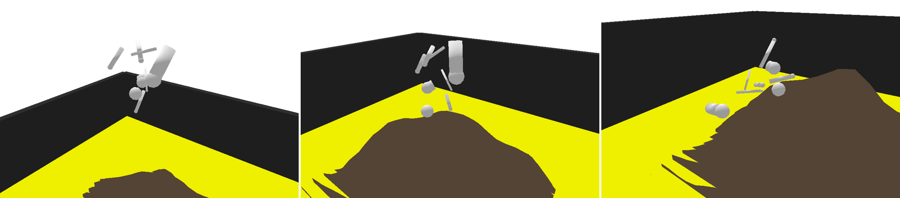
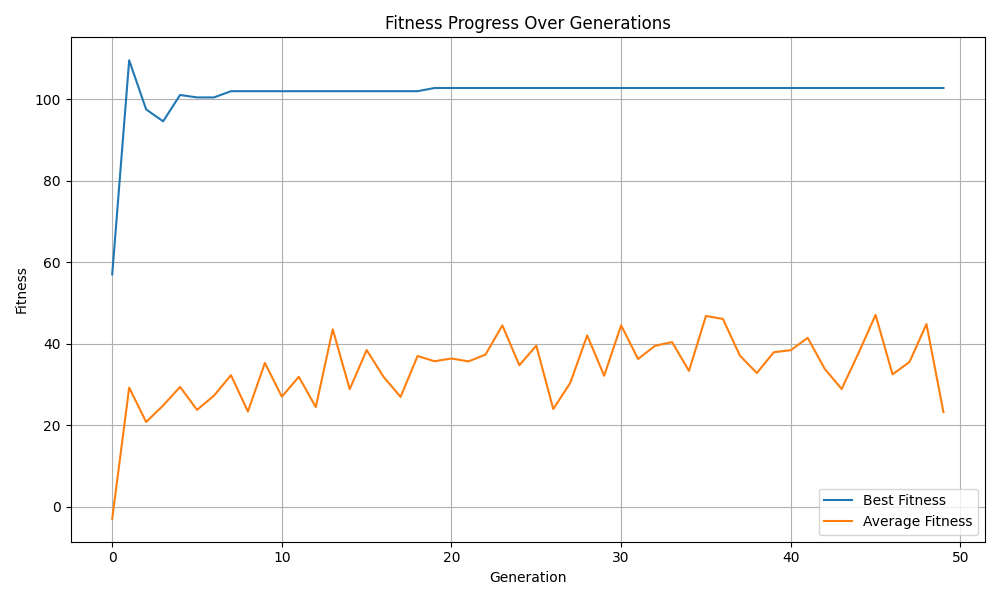
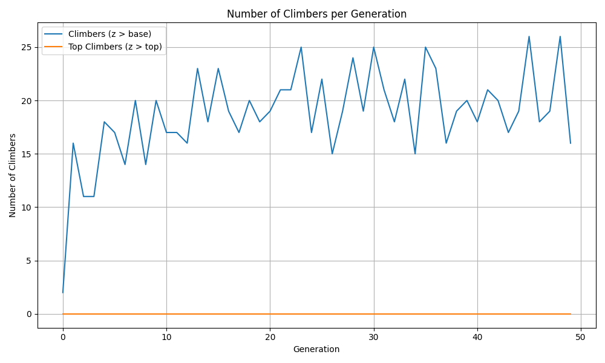

# Mountain Climbing Creatures

A **genetic algorithm** that evolves virtual creatures to climb a mountain in a physics simulation. Each creature is a tree of limbs and motorised joints built from a genome, simulated in **PyBullet**, scored by a multi-term fitness function and evolved over 50 generations. Written in Python.

Built on the course's starter framework (genome, creature and URDF generation for PyBullet). I wrote `ga_mountain.py` (the genetic algorithm, fitness function, logging and charts) and extended `genome.py` and `creature.py` (a tree-shaped genome with joint axes and per-limb motors, crossover and mutation operators, seed genomes).



<sub>Three frames from one simulation. This creature was evolved in a short test run of 8 generations; the charts below are from the full 50-generation run.</sub>



## How it works

**Creatures.** A genome is a list of genes, one per limb. Each gene has 18 values: limb length, radius and mass, the joint's type, axis and position, which earlier limb it attaches to, and its motor (sine or pulse waveform, amplitude, frequency, phase). Because a limb can attach to any earlier limb, bodies can branch into tripods, quadrupeds or radial shapes instead of a single chain. The genome is turned into a URDF robot description and loaded into the simulation.

**Environment.** A Gaussian-shaped mountain in a walled arena. A creature is dropped onto it from a height of 10 and its motors run for 28,800 steps (two minutes of simulated time at 240 steps per second).

**Fitness.** Rewards height gained and forward movement, and penalises doing nothing, shaking and leaving the arena. Vertical gain is the highest point reached minus the height the creature started from:

- `5 x forward progress + 40 x vertical gain`
- `+50` if the vertical gain is more than 0.05, `+30` if it stays more than 0.05 above its starting height for over 10% of the run, `+10` if it ends beyond y = 0.5
- `-5` if it neither gains height nor moves
- minus a vibration penalty (the spread of its height and how fast its joints move)
- `-10` if it ends outside the arena

**Evolution.** A population of 40 (8 seeded climbers and 32 random creatures). Each generation keeps the 2 best, breeds the rest by tournament selection (5 contestants), one-point crossover and mutation (point, grow and shrink), and adds 2 fresh random creatures to keep the population diverse.

## Results

Best fitness rose from 57 in the first generation to over 100 by generation 1 (peak 109.6) and settled at 102.8 from generation 19 on. The average fitness rose from -3 to between 21 and 47. The run counts a creature with a fitness of 50 or more as a climber: their number grew from 2 to 16 in generation 1 and reached 26 by generation 45. No creature reached the top-climber threshold of 200, which suggests the search stalled on a local peak.



The raw numbers are in `results/fitness_log.csv` and `results/climber_table.csv`.

## Known limitations

Three things I would change with more time. The results above are from the code as submitted, with these behaviours in place.

- **Height bonus.** Creatures start 10 units up and vertical gain is measured against that start height, not against the ground below them. In short test runs, the top-scoring creatures earned their bonus from rising about 0.2 above the drop height, not from reaching the top of the mountain, and none summited. Measuring height relative to the terrain would be the natural next step.
- **Motor assignment.** Motors are handed out to joints by index across all joints, including the fixed joints that attach the feet. Some motors therefore drive two joints and advance their clock twice per step.
- **Re-scoring.** A creature's motors keep their clock between evaluations, so the elites carried into the next generation start from a different phase and can score differently. This is why the best-fitness curve can dip.

## Run

```bash
pip install -r requirements.txt
cd src

# quick check (about a minute): 10 creatures, 3 generations, short simulations
python ga_mountain.py --pop_size 10 --generations 3 --steps 960 --seed 11

# the full run: 40 creatures, 50 generations (takes several hours)
python ga_mountain.py
```

It runs without a window by default. Add `--gui` to watch the simulation in the PyBullet window. `--seed` makes a run repeatable. The run writes `fitness_log.csv`, `climber_table.csv`, `fitness_progress.png` and `climber_counts.png` to the current folder.

The terrain in `src/shapes` comes with the starter framework. `prepare_shapes.py` generates new terrains and also needs `pip install noise`.

## Files

| File | Purpose |
|---|---|
| `src/ga_mountain.py` | The genetic algorithm, fitness function, logging and charts |
| `src/genome.py` | Genome encoding, URDF links, crossover, mutation and seed genomes |
| `src/creature.py` | Builds a creature and its motors from a genome |
| `src/shapes/` | Mountain terrain meshes |
| `src/test_*.py`, `src/simulation.py`, `src/population.py` | Starter framework tests and helpers |
| `results/` | Fitness log, climber table and charts from the 50-generation run |

## Tech Stack

Python · PyBullet · NumPy · pandas · matplotlib

## Author

Ziad Elhussein
